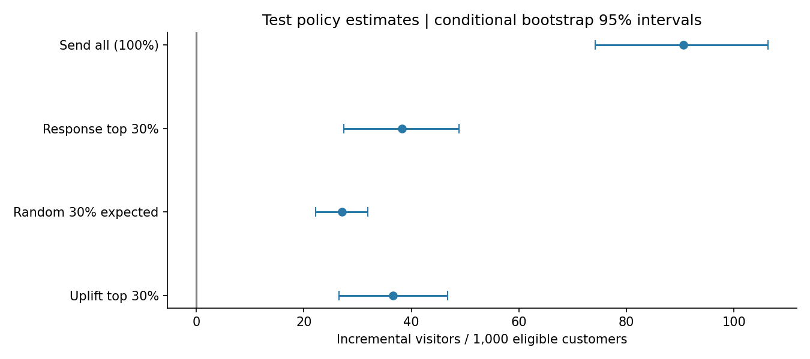

# 邮件营销实验评估与增量投放分析

基于Hillstrom 64,000条公开随机邮件实验记录，完成SQL质量核验、A/B/n效果评估、历史协变量调整、S/T/X增量建模和独立测试策略评估。

**本项目是AI辅助完成的公开数据离线实践，未实施新的线上实验，没有虚构课题组、导师、客户投放或已实现商业收益。** 数据与已有方法均注明来源；个人贡献按实际复现与修改情况描述。

## 核心发现

| 结果 | 实际数值 |
|---|---:|
| 男装邮件访问率 / 不发邮件访问率 | 18.28% / 10.62% |
| 男装邮件访问率绝对提升 | 7.66个百分点 |
| 女装邮件访问率绝对提升 | 4.52个百分点 |
| 男装邮件人均消费提升 | 0.770金额单位/分配客户/两周 |
| 男装访问效果ANCOVA方差缩减 | 约0.52% |
| 训练 / 验证 / 测试记录 | 25,567 / 8,523 / 8,523 |
| 验证选择模型 | T-Learner Logistic Regression |
| 测试30%增量排序策略 | 36.61名增量访问客户/千名合格客户 |
| 测试同容量随机策略期望 | 27.16名访问客户/千名合格客户 |
| 测试同容量普通响应排序 | 38.25名访问客户/千名合格客户 |

增量排序相对随机策略的差值约9.44，条件Bootstrap95%区间[1.39,17.25]；相对响应排序的差值约-1.64，区间[-12.09,8.21]，**不能声称增量模型明确胜过普通响应模型**。这些是离线条件估计，不是线上保证。



## 从哪里开始

1. `reports/dashboard.html`：浏览器直接打开的自包含展示页。
2. `docs/interview_handbook.docx`或同名`.md`：项目故事、44个面试问题、简历条目和学习安排。
3. `reports/results.md`：完整实际结果。
4. `docs/methodology.md`：公式、假设、评估定义和局限。
5. `docs/run_guide.md`与`notebooks/walkthrough.ipynb`：运行和逐步理解。

## 一键复现

推荐Python 3.12。在根目录创建并激活虚拟环境后：

```bash
python -m pip install -r requirements.txt
python run_all.py
python -m unittest discover -s tests -v
```

首次需要网络下载数据并核验摘要，后续读取本地缓存。无需GPU、API key和数据库账号。发布包不附原始数据及逐行预测，见`docs/sources.md`。所有聚合结果和图已附带，可直接查看。

## 实际使用的方法与工具

- DuckDB SQL：GROUP BY、CASE WHEN、FILTER、CTE、NTILE窗口汇总。
- SciPy / statsmodels：Welch均值差、SRM、Holm、HC2 ANCOVA、功效样本量规划。
- NumPy / pandas：质量核验、IPW、1500次Bootstrap、分位与排名统计。
- scikit-learn：独热编码、标准化、逻辑回归、直方图梯度提升，独立实现S/T/X。
- Matplotlib：7张图；HTML静态展示无需服务器。

参考EconML、CausalML与tea-tasting的公开方法文档，但未调用它们的运行库。没有实现因果森林、DML、序贯实验或真实营销归因，不把这些列成已完成方法。

## 目录与分析流程

`config.json`固定对象、容量与随机种子；`src/download_data.py`下载与校验；`src/run_analysis.py`执行SQL、统计与建模；`src/statistics_tools.py`实现透明估计；`src/uplift_models.py`实现元学习器；`src/build_reports.py`生成图表、报告和HTML；`tests/`包含15项核验。

没有客户ID，所以6,562条完全相同画像不直接去重。所有指标使用原分配记录作为分母，不在处理后访问者中筛选。主实验六项检验进行Holm校正；图上95%区间为边际区间。模型依据验证集30%容量HT增量选择；测试不反向挑选模型。没有日期字段，不能声称时间外推。

## 参考与许可

数据：Kevin Hillstrom，MineThatData Email Analytics Challenge (2008)，通过scikit-uplift公开加载器引用的镜像下载。方法：Künzel等(2019)元学习器、Deng等(2013)CUPED思想及官方方法文档。完整链接见`docs/sources.md`。

自行编写代码为MIT；该许可不覆盖原始数据、第三方方法或库。没有擅自替数据提供者赋予开放许可。
